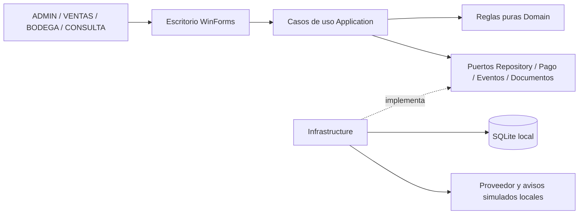
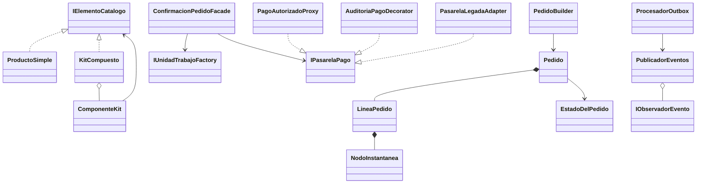
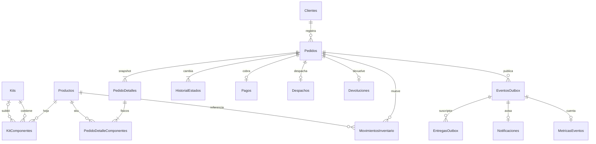
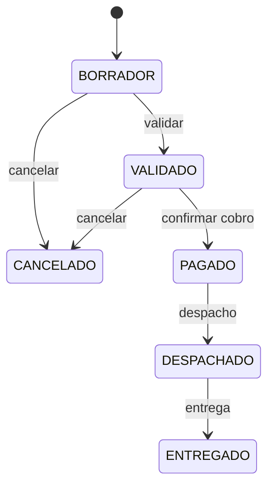
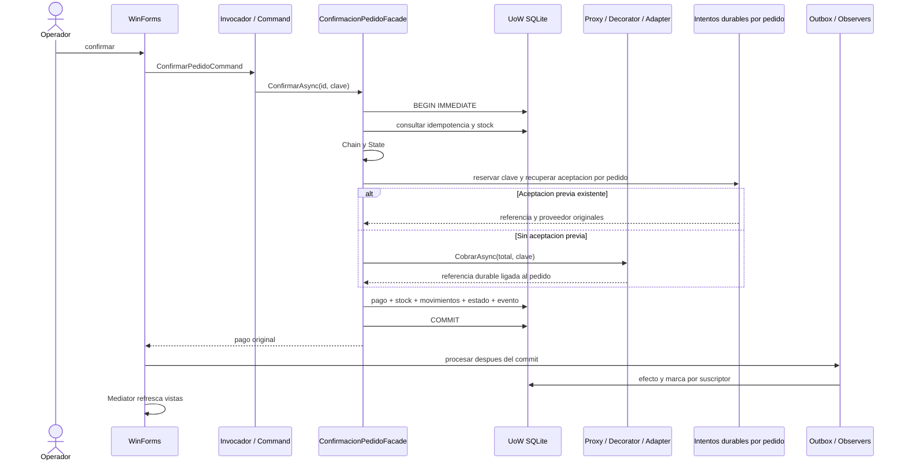
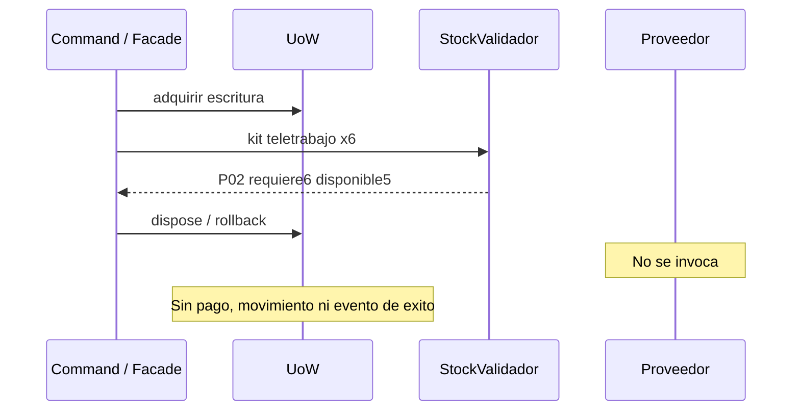

# Arquitectura y trazabilidad tecnica

## Requisitos funcionales

| ID | Requisito verificable / caso de uso | Evidencia |
| --- | --- | --- |
| RF01 | Acceso local por hash, rol y cierre de sesion | prueba AccesoHashYPermisosSinInterfaz; capturas 01/20/21 |
| RF02 | CRUD y busqueda de SKU, precio positivo, peso/stock no negativos | pruebas originales de Producto; RestriccionesSqliteReales; CatalogoVista |
| RF03 | Kits anidados, cantidades y ciclos prohibidos | P18, P27, P34; captura 04 |
| RF04 | Clientes activos con categoria editable | ClienteTests; captura 05/06/07 |
| RF05 | Borradores guardados, clonacion y cinco estados undo/redo | P13/P14/P29; EdicionPersistidaTests; capturas 08/09/10 |
| RF06 | Promociones excluyentes y entrega por familia | P02/P03/P04/P12/P32 |
| RF07 | Validacion encadenada y transiciones legales | P05/P08/P09/P23/P31 |
| RF08 | Cobro idempotente y cambio de proveedor | P06/P07/P16/P19/P22/P24; capturas 12/13 |
| RF09 | Guia, seguimiento y entrega por BODEGA | P09/P12/P31; capturas 18/19/25 |
| RF10 | Devolucion total, plazo/motivo, reembolso sin flete | P33/P35; pruebas de limites; capturas 22/23 |
| RF11 | Inventario agrupado por SKU y movimientos referenciados | P02/P05/P07/P35/P36; captura 24 |
| RF12 | Reportes con parser y comprobantes por dos salidas | P17/P25/P26; capturas 26-32 |
| RF13 | Eventos, tres observadores y recuperacion de pendientes | P11/P30/P37; capturas 15/17/41/42 |
| RF14 | Auditoria, metricas unicas y demostraciones reales | P15/P19/P21/P28; capturas 33/37/38/40 |

## Requisitos no funcionales

| ID | Criterio medible | Verificacion |
| --- | --- | --- |
| RNF01 Integridad | Cero stock negativo y cero sobreventas entre dos conexiones | P36 y restricciones SQL |
| RNF02 Mantenibilidad | Cinco proyectos; cero referencias externas en el nucleo | P38, csproj y build limpio |
| RNF03 Usabilidad | Doce vistas; TAB, etiquetas, ErrorProvider, seleccion conservada y confirmaciones | recorrido Windows y validacion de cliente vacio |
| RNF04 Rendimiento | 1000 filas Flyweight con cinco metadatos; medicion equivalente | P21 y captura 37/38; bytes asignados reales |
| RNF05 Seguridad local | Cuatro roles, PBKDF2 salado, denegacion previa al proveedor y su log | P22 y AccesoHashYPermisosSinInterfaz |
| RNF06 Trazabilidad | Cada transicion, pago, movimiento y comando tiene identidad/referencia | P19/P24/P31/P35 y traza UI |
| RNF07 Testabilidad | Al menos 25 pruebas en dominio/aplicacion/integracion; bases aisladas | TRX final y suite P01-P38 |
| RNF08 Recuperabilidad | Seed no destructivo y Outbox reanudado sin repetir efectos | P07/P10/P37; reinicios reales UI |

## Contexto y componentes

Referencias de compilacion: Domain ninguna; Application a Domain; Infrastructure a Application/Domain; WinForms a Application e Infrastructure para composicion; Tests a las tres capas internas. `WinForms/Program.cs` es el unico archivo de presentacion que importa Infrastructure. Los formularios reciben servicios por constructor y se refrescan mediante FormularioPrincipalMediator.

## Modelo relacional

Usuarios almacena rol y hash. Auditorias guarda comandos, eventos y entrega con correlacion. El historial de transiciones esta normalizado. El arbol JSON de cada linea preserva la estructura anidada; PedidoDetalleComponentes tambien almacena hojas fisicas normalizadas con FK al SKU. No se usa JSON como sustituto de pagos, existencias o relaciones. Los importes son decimal en C#; SQLite los conserva como TEXT decimal y las restricciones numericas usan CAST. Las consultas interpretadas se evaluan sobre objetos tipados, sin SQL concatenado.

## Estados

La devolucion unica se representa con relacion y bandera Devuelto; no introduce un estado ajeno a la lista oficial. Cada estado es un colaborador con sus acciones validas; no hay un switch central que cambie estados.

## Secuencias

## Fuentes tecnicas consultadas

- [Proveedor oficial EF Core SQLite 8.0.34](https://www.nuget.org/packages/Microsoft.EntityFrameworkCore.Sqlite/8.0.34).
- [Microsoft.Data.Sqlite: transacciones y bloqueo de escritores](https://learn.microsoft.com/en-us/dotnet/standard/data/sqlite/transactions).
- [EF Core: transacciones](https://learn.microsoft.com/en-us/ef/core/saving/transactions).

Los requisitos funcionales se contrastaron con las 20 paginas de `requisitos/GUIA_APE_04.pdf`. Este documento es material tecnico de revision; no sustituye el informe academico aplazado.
